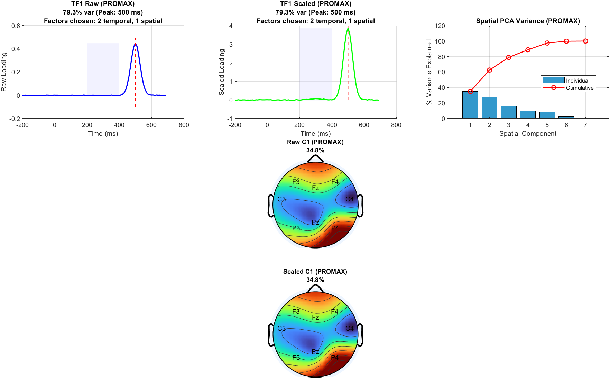

# Synthetic example: Pooled ERP PCA with known synthetic sources

Download the [repository ZIP with the example and readiness fixes](https://github.com/MPG-Git/Spatiotemporal_PCA_Data_Driven/archive/refs/heads/codex/readiness-20261107.zip),
extract it to a writable folder, and follow the setup below. These changes are
on the review branch; downloading the older default branch may omit them.
The input files and reference outputs are already included; generation is optional.

## Run and inspect

This is a MATLAB/EEGLAB workflow. Install EEGLAB and MATLAB Statistics and
Machine Learning Toolbox. From the extracted repository folder:

```matlab
addpath('C:/path/to/eeglab'); % your installation
eeglab nogui;
addpath('examples/synthetic');
run_pca_demo;
```

Reference run: MATLAB R2023b and EEGLAB 2024.2. `data/group_one` and
`data/group_two` contain four `.set` files each. Each synthetic subject has
8 located channels, 2,000 samples at 100 Hz, and seven `stim` events. Gaussian
pulses at 300 and 500 ms are mixed with noise; subject/channel amplitudes vary.
The generation seed is 7; the analysis seed is 71. All values are in microvolts.

The runner epochs -0.2 to 0.7 s, baseline-corrects -200 to 0 ms, highlights the
200-400 ms ERP window, and uses 10 parallel-analysis permutations for speed.
The reported peak is taken across the full loading waveform, so the 500 ms
factor can peak outside the highlighted window.
The reference retains **2 temporal factors and 1 spatial factor**, producing
four `pca_<ROTATION>_TF<NN>.mat` files (Varimax and Promax, TF01 and TF02).
Reports, PNG/FIG figures and `analysis_metadata.mat` are created in your output.
The included reference report and two example PNGs show what to expect.

Each rotation must reconstruct the same retained temporal signal with relative
error below 1e-10. Temporal loading Gram matrices are exported to CSV and compared
with the bundled numeric references at relative Frobenius tolerance 1e-6.
These comparisons tolerate sign changes of individual factors. Factor counts
must match. Plot pixels and provenance paths are not compared.

Ten permutations are for an installation example, not a final analysis. The
workflow pools selected events; it uses a global spatial retention count capped
by each factor's available rank. Oblique factor variance is not additive.
Example success is not evidence for a study-specific factor-selection model.



Recreate all eight input datasets with `generate_pca_data('new_data')`.

## What counts as success

A successful run prints `PASS` and writes `PASS.txt` and `comparison.csv` into
the new output folder. Errors and mismatches stop the runner without a PASS file.
Open the CSV comparison and compare your plots with `expected/`.
The included reference outputs came from actual runs on November 7, 2026.

The default output is this example's `output/` directory. Existing output folders
are refused so a previous result cannot be mistaken for a fresh run. MATLAB
runners accept a new output folder as their first argument (for example,
`run_pca_demo('demo_run_2')`).

If a comparison fails, inspect the reported metric and confirm that you used
these bundled files, this repository version, and the listed dependencies.
Do not replace the reference with the failing result. `SHA256SUMS.json` records
input/reference file hashes for download-integrity checks. All input data are
generated; no participant recordings or personal data are included. The supplied
generators refuse to overwrite an existing destination.

These examples check the illustrated installation and workflow, not every menu
item or scientific validity for a particular study. Reference plots may render
differently with another operating system or graphics version.
